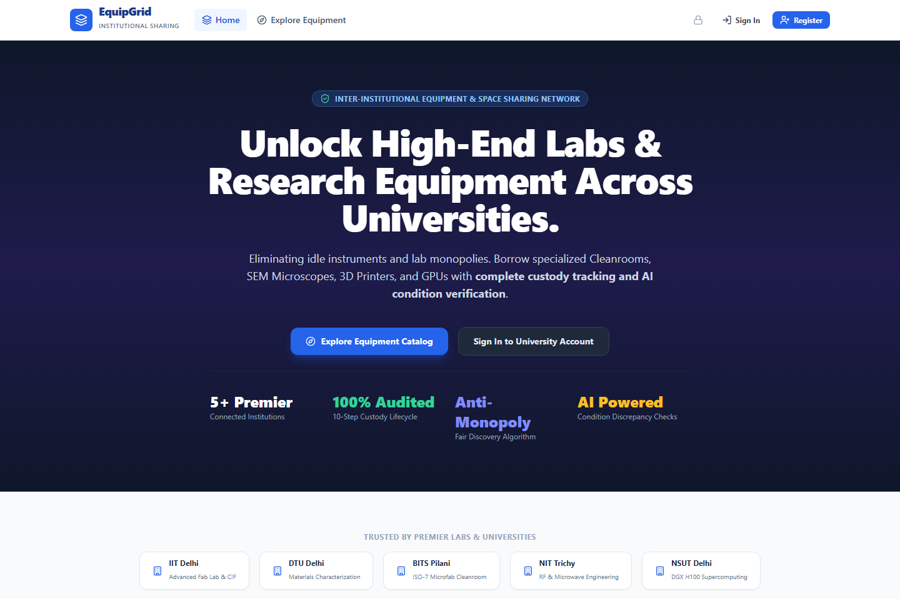
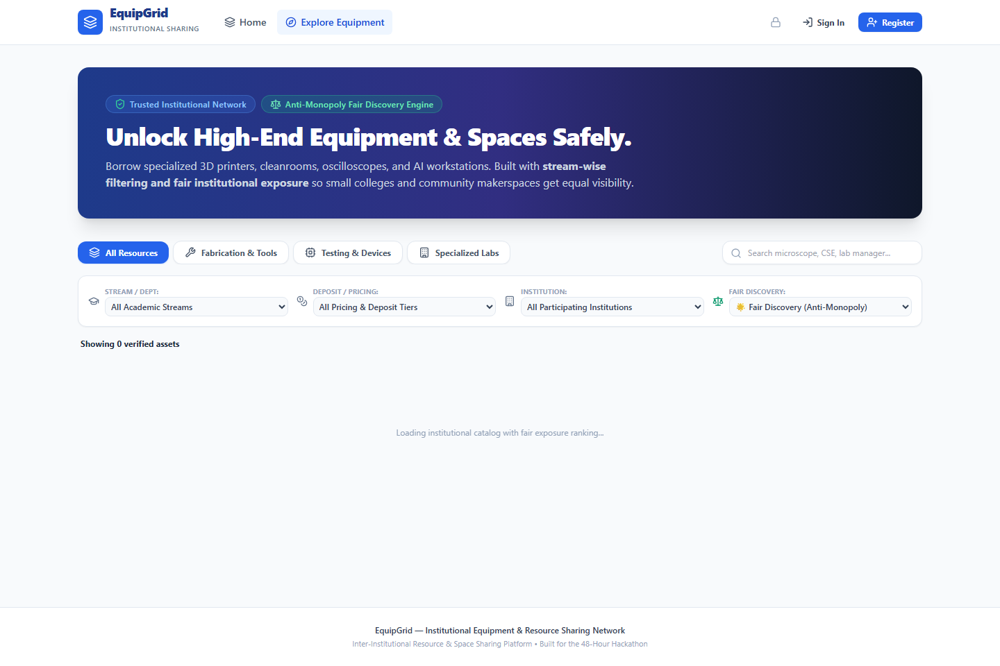
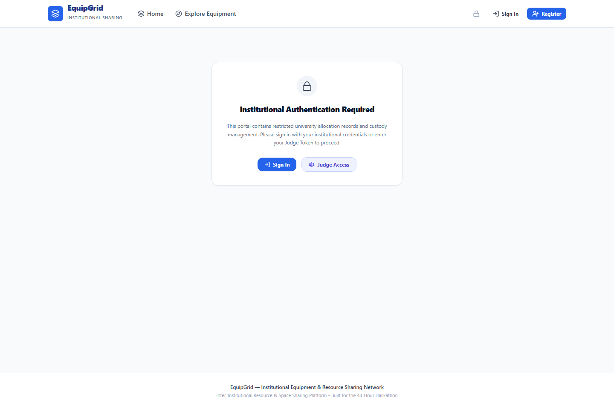

# 🔬 EquipGrid — Institutional Resource & Equipment Sharing Platform

> **A trusted platform enabling universities, research labs, and makerspaces to safely share high-value equipment, specialized facilities, and tools with verified custody, fair allocation, transparent caution deposits, and an immutable audit trail.**

[](https://github.com/rajeevkumar-git)
[](https://fastapi.tiangolo.com)
[](https://vitejs.dev)
[](https://tailwindcss.com)
[](https://ai.google.dev)
[]()

---

## 📌 Problem Statement & Vision

Modern engineering colleges and national research facilities house specialized instruments (e.g., stereolithography 3D printers, RF oscilloscopes, SEM microscopes, cleanroom benches) valued at tens of lakhs of rupees. In practice, these instruments often operate at less than 35% utilization outside scheduled lab hours. Simultaneously, undergraduate innovators, interdisciplinary scholars, and early-stage incubators face insurmountable cost barriers when trying to access this infrastructure.

Traditional calendar and room-booking systems cannot solve this crisis because they fail to address:
- **Custody Verification:** Who operated the machine, under what condition was it received, and in what state was it returned?
- **Anti-Monopoly Allocation:** Preventing single research groups from locking down high-demand assets.
- **Financial Protection:** Transparent caution deposits, automated UPI refund guarantees, and scholar waivers.
- **Accountability:** Non-repudiable audit logs that satisfy institutional compliance and accreditation standards.

**EquipGrid bridges this gap** by providing a comprehensive, trust-first digital ecosystem uniting students, lab managers, and institutional administrators under a unified governance and allocation framework.

---

## 🏛️ Platform Architecture

```
┌─────────────────────────────────────────────────────────────────────────┐
│                           Client Layer (React + Vite)                  │
│  - Academic Stream Filtering   - 10-Step Custody Lifecycle UI           │
│  - Role-Based Dashboards       - Two-Stage Indian Payment Modal        │
│  - Real-Time Reviewer Switcher - Responsive Glassmorphism Design        │
└────────────────────────────────────┬────────────────────────────────────┘
                                     │ REST APIs / Bearer Auth
┌────────────────────────────────────▼────────────────────────────────────┐
│                         FastAPI Application Server                      │
│  ┌───────────────────────┬───────────────────────┬───────────────────┐  │
│  │   Auth & RBAC Router  │   Bookings Lifecycle  │  Resources Router │  │
│  │   - Case Normalization│   - State Transitions │  - Stream Filters │  │
│  │   - Duplicate Defense │   - Quota Enforcement │  - Supervision    │  │
│  └───────────────────────┴───────────────────────┴───────────────────┘  │
│  ┌───────────────────────┬───────────────────────┬───────────────────┐  │
│  │  Fairness Engine      │   Gemini 1.5 Flash AI │  Audit Ledger     │  │
│  │  - Priority Scoring   │   - Discrepancy Check │  - Immutable Logs │  │
│  │  - Cooldown Tracking  │   - Rejection Explan. │  - Actor Stamping │  │
│  └───────────────────────┴───────────────────────┴───────────────────┘  │
└────────────────────────────────────┬────────────────────────────────────┘
                                     │ SQLAlchemy ORM
┌────────────────────────────────────▼────────────────────────────────────┐
│                    SQLite Database / Storage Layer                      │
│   - Users & Roles        - Resources & Slots     - Bookings & Custody   │
│   - Condition Records    - Audit Activity Logs   - Dispute Incidents    │
└─────────────────────────────────────────────────────────────────────────┘
```

---

## 🌟 Key Features & Capabilities

### 1. 🎓 Academic Stream-Wise Resource Discovery (30 Verified Assets)
Filter specialized lab resources by departmental stream or engineering domain:
- **Computer Science & AI (CSE):** NVIDIA DGX Supercomputing Cluster, Dual RTX 4090 Workstations, Edge TPU Racks, Cyber-Physical IoT Testbeds, High-Speed Vision Kits.
- **Mechanical & Prototyping:** Industrial Formlabs Form 3+ SLA, Haas 3-Axis CNC Machining Centers, CO2 Laser Cutters, 100kN Universal Testing Machines (UTM).
- **Electronics & VLSI (ECE):** Keysight 1 GHz Oscilloscopes, Keysight 50 GHz Spectrum Analyzers, Rohde & Schwarz 40 GHz VNAs, Xilinx RFSoC Development Clusters.
- **Nanotechnology & Physics:** Field Emission SEMs (FE-SEM), Atomic Force Microscopes (AFM), 9kW Rotating Anode XRDs, ISO Class 5 Cleanroom Photolithography Benches.
- **Biotechnology & Life Sciences:** Eppendorf BioFlo Fermentation Bioreactors, Preparative Ultracentrifuges, Confocal Laser Scanning Microscopes, High-Speed Cell Sorters.
- **Civil & Environmental Engineering:** Automated Triaxial Soil Mechanics Systems, Robotic Total Station Laser Surveying & LiDAR Suites.

### 2. 🔄 End-to-End 10-Step Custody Lifecycle
1. **Resource Publication:** Lab in-charges publish instruments with baseline specs, photos, supervisor requirements, and usage rules.
2. **Catalog Discovery:** Researchers view live availability, hourly rates, and certification requirements.
3. **Reservation Request:** Borrowers select slots and submit a structured research purpose and project code.
4. **Fairness Evaluation:** The automated engine calculates priority scores and validates monthly caps.
5. **Lab In-Charge Review:** Faculty/Managers review pending requests with AI qualification summaries.
6. **Approval & Slot Hold:** Slots are locked, and calendar confirmations are issued to the researcher.
7. **Physical Check-In:** Borrower and lab staff inspect the equipment and complete an itemized checklist before power-on.
8. **Return & AI Discrepancy Verification:** Upon session conclusion, return condition is scored. Google Gemini 1.5 Flash inspects before/after states to flag discrepancies.
9. **Incident Reporting & Quarantine:** If physical damage or misuse is flagged, the asset is automatically quarantined for technician inspection.
10. **Immutable Audit Trail:** Every status change, signature, and approval is timestamped and recorded in the audit ledger.

### 3. 💳 Transparent Indian Academic Payment Split
To safeguard institutional equipment while remaining accessible to self-funded students:
- **Advance Caution Deposit (100% Refundable):** Held in escrow and automatically unlocked via UPI upon incident-free return verification.
- **Runtime Operational Fee:** Modest hourly charges covering electricity, specialized consumables, and lab wear-and-tear.
- **High-Trust Scholar Waiver:** Scholars with a trust score $\ge 0.95$ receive an automatic security deposit waiver.
- **Direct UPI / NetBanking Mock Gateway:** Fast, realistic checkout workflow with instant status confirmation.

### 4. 🤖 AI-Powered Inspection & Fairness (Google Gemini 1.5 Flash)
- **Visual & Condition Discrepancy Detection:** Analyzes condition notes and discrepancy reports between check-in and checkout to provide neutral severity ratings.
- **Fair Rejection Explanations:** Automatically generates constructive, polite reasoning when a booking must be declined due to quota limits or supervisor absence.
- **Anti-Monopoly Priority Engine:**
  $$\text{Priority Score} = 0.30 \times \text{Trust} + 0.30 \times \text{WaitTime} - 0.20 \times \text{Usage} + 0.10 \times \text{Relevance} - 0.10 \times \text{Incidents}$$

### 5. 📞 Direct Lab Manager Support Channels
Every equipment listing and booking detail view includes direct contact action pills:
- **Call Lab In-charge:** Direct dial to the lab manager or instrument technician.
- **Official Email:** Auto-formatted inquiry emails with booking and asset IDs pre-filled.
- **Instant WhatsApp Coordination:** Fast desk chat for lab directions and schedule coordination.

### 6. 🛡️ Hardened Authentication & Route Security
- **Case-Insensitive Credential Normalization:** Prevents duplicate account creation or spoofing through email casing variations (`User@iitd.ac.in` vs `user@iitd.ac.in`).
- **Fail-Safe Integrity:** Database-level uniqueness constraints backed by transaction rollbacks prevent duplicate submissions under high concurrency.
- **Protected Route Guards:** Critical management areas (`/manager-dashboard`, `/student-dashboard`, `/audit-history`, `/new-resource`) are strictly safeguarded against unauthenticated access.
- **Direct Workspace Routing:** Authenticated users are directed straight to their respective workflows, bypassing generic marketing landers.

---

## 👥 Role Capabilities Matrix

| Functionality | Student / Researcher | Lab In-charge / Faculty | Institutional Admin | Reviewer / Evaluator |
| :--- | :---: | :---: | :---: | :---: |
| **Browse Catalog & Filters** | ✅ | ✅ | ✅ | ✅ |
| **Request Equipment Slots** | ✅ | ✅ | ✅ | ✅ |
| **Caution Deposit & UPI Split** | ✅ | — | — | ✅ |
| **Check-in / Return Inspection** | ✅ | ✅ | ✅ | ✅ |
| **Add / Edit Lab Equipment** | — | ✅ | ✅ | ✅ |
| **Approve / Reject Bookings** | — | ✅ | ✅ | ✅ |
| **Quarantine Damaged Equipment** | — | ✅ | ✅ | ✅ |
| **View System-Wide Audit Logs** | — | — | ✅ | ✅ |
| **1-Click Multi-Persona Switcher** | — | — | — | ✅ |

---

## ⚡ Quick Start & Installation

### Prerequisites
- **Python:** 3.10 or higher
- **Node.js:** 18.x or higher (`npm` included)
- **Git**

### 1. Clone the Repository
```bash
git clone https://github.com/rajeevkumar-git/EquipGrid.git
cd EquipGrid
```

### 2. Backend Setup (FastAPI)
```bash
cd backend

# Create and activate virtual environment
python -m venv venv
# On Windows:
venv\Scripts\activate
# On Linux/macOS:
# source venv/bin/activate

# Install dependencies
pip install -r requirements.txt

# Clean-wipe previous catalogs and seed 30 verified resources with realistic pricing & slots
python seed_data.py

# Start the development server
uvicorn app.main:app --reload --port 8000
```
- **Interactive Swagger Documentation:** [http://localhost:8000/docs](http://localhost:8000/docs)
- **Redoc Documentation:** [http://localhost:8000/redoc](http://localhost:8000/redoc)
- **Catalog Reseed Maintenance Endpoint:** `POST /api/resources/reseed` (instant cloud catalog reset)

### 3. Frontend Setup (React + Vite + TailwindCSS)
In a new terminal window:
```bash
cd frontend

# Install Node modules
npm install

# Start Vite dev server
npm run dev
```
- **Application Portal:** [http://localhost:5173](http://localhost:5173)

---

## 🧪 Testing & Verification

EquipGrid comes with automated verification coverage ensuring that authentication, duplicate prevention, and cross-role workflows operate reliably.

Run backend verification:
```bash
cd backend
python -c "import fastapi, sqlalchemy; print('Environment verified successfully')"
```

Build the production frontend bundle:
```bash
cd frontend
npm run build
```

---

## 🧭 Evaluator & Reviewer Guided Tour

For hackathon judges and institutional evaluators, EquipGrid includes a discreet, single-row role switcher in the navigation bar allowing instant evaluation across all roles without repeated sign-ins:

1. **Step 1 — Student Exploration:**
   - Open `http://localhost:5173`.
   - Filter by academic stream (*e.g., Mechanical & Fabrication*).
   - Select the **Formlabs Form 3+ SLA 3D Printer**.
   - Notice the two-stage payment breakdown: ₹2,000 caution deposit (100% UPI refund guarantee) + ₹250/hr runtime fee.
   - Click **"Request Slot"**, specify your project purpose, and submit.
2. **Step 2 — Lab Manager Review:**
   - Click the green switcher in the navbar to switch to **Lab In-charge (Dr. Priya Roy)**.
   - Navigate to **"Lab Dashboard"**.
   - Review the student's reservation request and click **"Approve Slot"**.
3. **Step 3 — Custody Check-In & AI Return:**
   - Switch back to **Student (Aarav Singh)**.
   - Go to **"Student Dashboard"** → Select your active booking.
   - Complete physical custody check-in.
   - On return, test a condition change (*e.g., Fair or Needs Cleaning*) to observe the Gemini AI condition discrepancy analysis.
4. **Step 4 — Administrative Audit Trail:**
   - Switch to **Admin (Institutional Head)**.
   - Open **"Audit History"** from the navigation menu to review the immutable, timestamped record of every user action.

---

## 📸 Application Previews & UI Gallery

High-resolution visual captures from the verified live environment:

| View | Screenshot Preview | Description |
| :--- | :--- | :--- |
| **01. Institutional Portal** |  | Landing portal highlighting trusted inter-institutional equipment sharing and 10-step custody lifecycle. |
| **02. Stream-Wise Catalog** |  | 30 verified academic instruments across CSE, ECE, Mechanical, Nanotech, Biotech, and Civil with realistic pricing. |
| **03. Student Dashboard** |  | Active borrower reservations, two-stage UPI caution deposit split receipts, and check-in status. |
| **04. Lab Manager Dashboard** |  | Faculty reservation approvals, condition checklist reviews, and equipment status controls. |
| **05. Audit History Ledger** |  | Immutable cryptographic SHA-256 audit log tracking every reservation, return, and financial clearance. |

> 📘 **Detailed Technical Documentation:** For the exhaustive 12-section architecture guide, mathematical priority scoring models, and QA verification manual, see [`EQUIPGRID_MASTER_TECHNICAL_REPORT_FOR_AMAN.md`](EQUIPGRID_MASTER_TECHNICAL_REPORT_FOR_AMAN.md).

---

## 📁 Repository Structure

```
EquipGrid/
├── backend/
│   ├── app/
│   │   ├── core/           # Security, password hashing, JWT dependencies
│   │   ├── models/         # SQLAlchemy schemas (User, Resource, Booking, AuditLog)
│   │   ├── routers/        # API endpoints (Auth, Resources, Bookings, Audit, Incidents)
│   │   ├── services/       # Gemini AI service, allocation engine, audit logger
│   │   ├── database.py     # Database session management
│   │   ├── main.py         # FastAPI application entrypoint
│   │   └── schemas.py      # Pydantic validation models
│   ├── seed_data.py        # Institutional seed fixtures
│   ├── requirements.txt    # Python dependencies
│   └── README.md
├── frontend/
│   ├── public/             # Static public assets
│   ├── src/
│   │   ├── api/            # Axios API client & mock fallbacks
│   │   ├── components/     # Navbar, AuthModal, BookingModal, RoleSwitcher
│   │   ├── context/        # AuthContext & persistent state
│   │   ├── pages/          # Catalog, Dashboards, AuditLogPage, NewResource
│   │   ├── App.jsx         # React Router & protected route definitions
│   │   └── main.jsx        # App mounting
│   ├── package.json
│   ├── tailwind.config.js
│   └── vite.config.js
└── README.md
```

---

## 👥 Core Development Team

| Member | Role | Focus Areas |
| :--- | :--- | :--- |
| **Rajeev (Lead)** | **Full-Stack & System Architect** | System architecture, React frontend, auth hardening, reviewer access, and cloud integration. |
| **Farhan** | **Backend Engineer (Python)** | FastAPI REST services, relational models, booking state machine, and custody workflows. |
| **Shubham** | **AI/ML & Smart Allocation** | Fair allocation anti-monopoly engine, Gemini API multimodal discrepancy analysis, and audit logging. |
| **Aman** | **Product QA & Documentation** | Realistic equipment datasets, comprehensive multi-role testing, user documentation, and submission guides. |

---

## 📄 Intellectual Property & Institutional Rights
EquipGrid was created as original proprietary software developed for institutional equipment sharing, optimization, and hackathon evaluation. All rights are reserved by the development team.

All equipment brand names, model trademarks, manufacturer insignias, and institutional names cited across the dataset (e.g. Keysight, Haas, Formlabs, Zeiss, NVIDIA, IIT Delhi, DTU, NSUT) belong strictly to their respective registered holders and are utilized solely for educational simulation and prototype demonstration.
